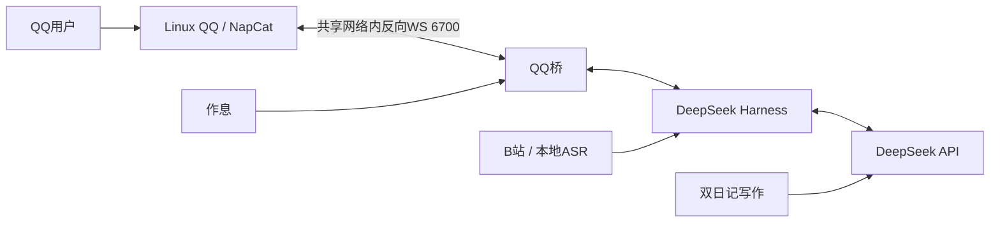

# 安装与连接排错

入口是 `bash install.sh`，不复制作者profile或单独手工安装Linux QQ。

DSH Web绑定具体容器网卡地址，Docker仅发布到宿主127.0.0.1。NapCat与应用共享容器网络，因此反向WS是127.0.0.1:6700；两者也挂载同路径的媒体目录，发图不用跨容器重写路径。

| 现象 | 处理 |
| --- | --- |
| 镜像/包下载失败 | 看安装最后的报错，调整Docker/PyPI/npm网络后重跑；不把代理地址写成API Key |
| 网页打不开 | `bash fishctl status`；远程机器需SSH转发 |
| 网页口令错误 | `bash fishctl access --show-secrets`；已存在WebUI以其私有配置的口令为准 |
| 服务健康但QQ不回 | 确认扫码、反向WS，再查准确账号和群白名单；健康不表示账号在线 |
| 某个群友不回 | 将他加入friends/allowUsers后重启应用 |
| 网页端口冲突 | 改.env中宿主端口再up，不结束无关进程 |
| B站没有语音理解 | 查看data/app/logs/speech-model.log；模型下载前可继续用画面摘要 |
| 语音失败 | edge-tts需联网；文字继续，查看data/app/logs/tts.log |

DSH使用锁定版本，不调用系统可能同名的其他dsh命令。重启保留面板和NapCat的非受管设置；安装器管理的账号、白名单与fish连接有变化时会先保存私有 `.bak`。若自定义YAML含无法安全读取的标签，启动会报错并保留原文件。
